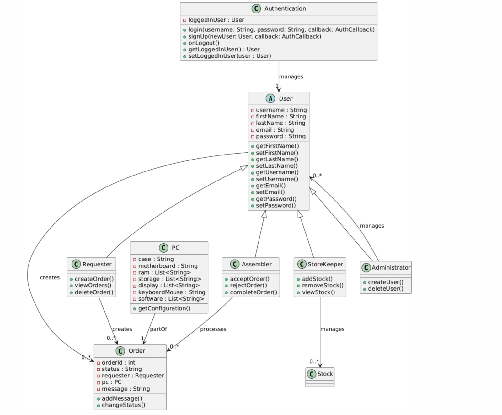
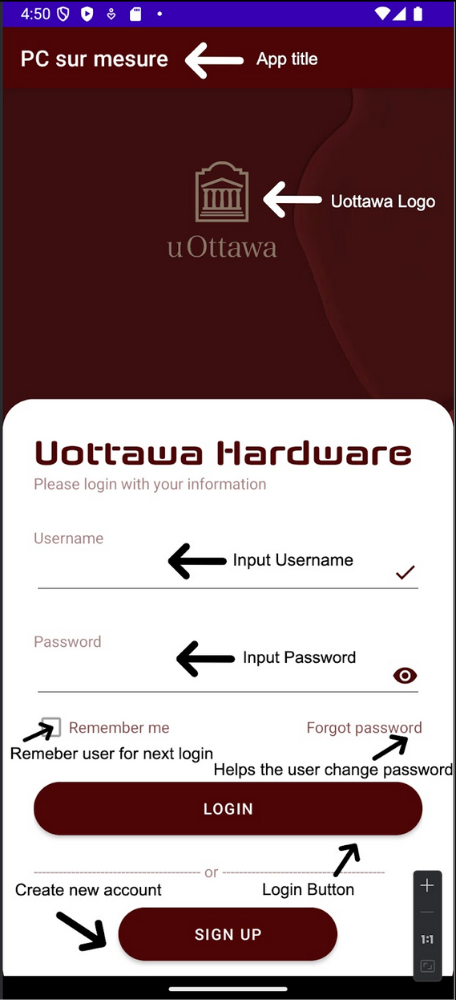
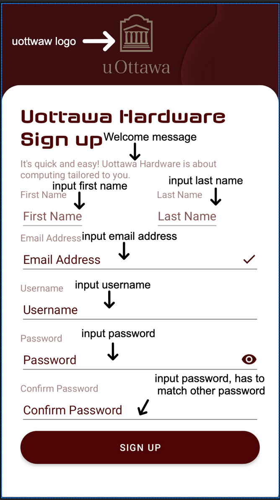
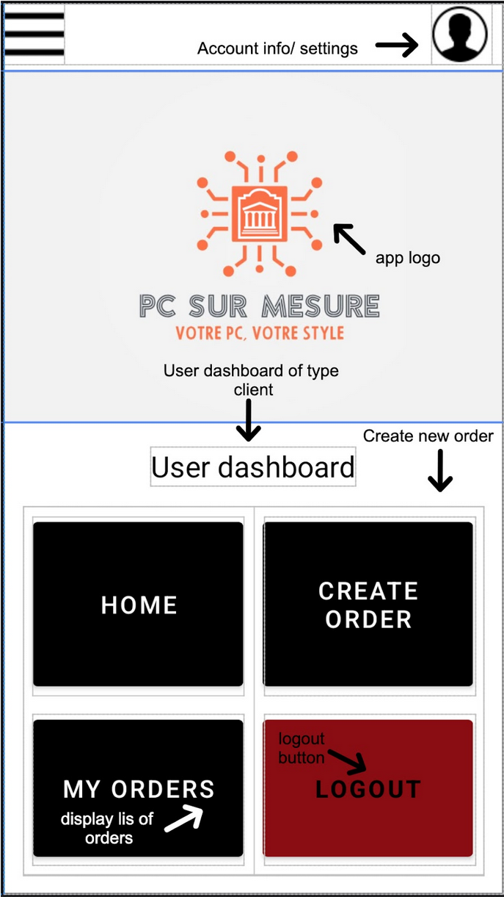
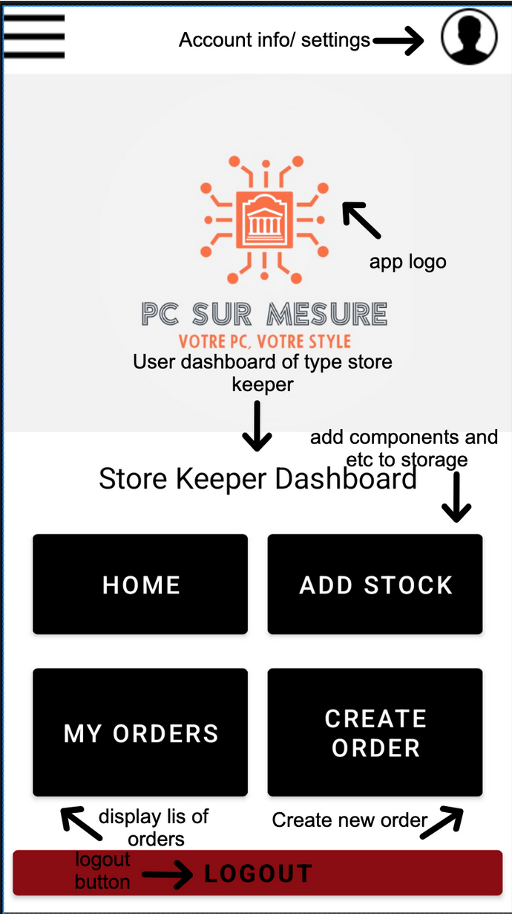
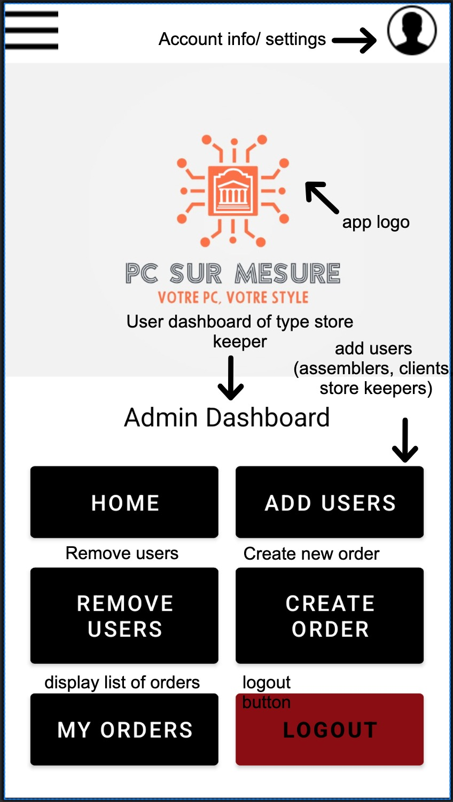
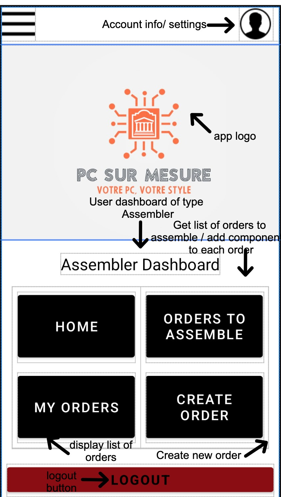
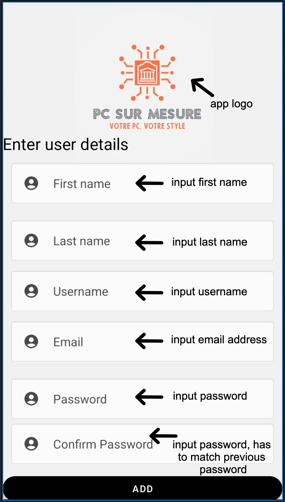
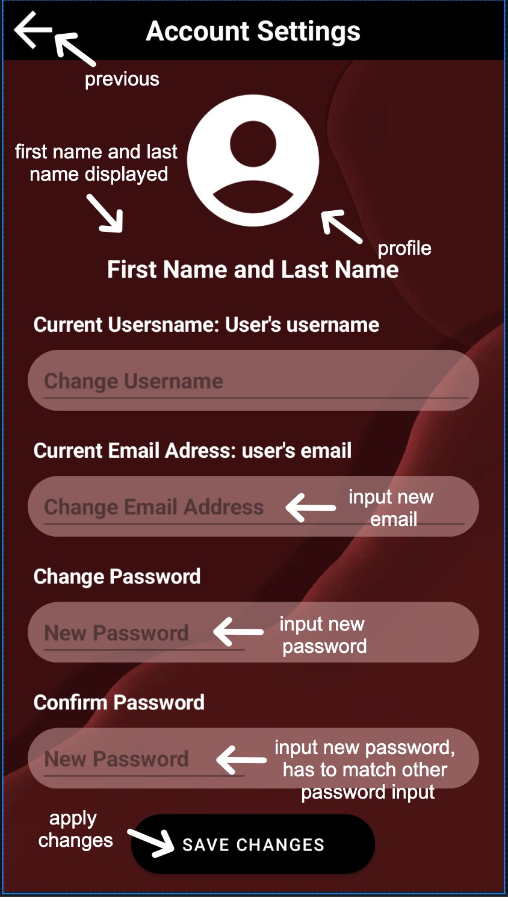

# First Version of "PC Sur Mesure"

[← Back to README](README.md)

## Class diagram

---

## Login page

---

## Sign-up page

---

## Home pages

### Requester home page

### StoreKeeper home page

### Admin home page

### Assembler home page

---

## Add user

## Account settings

